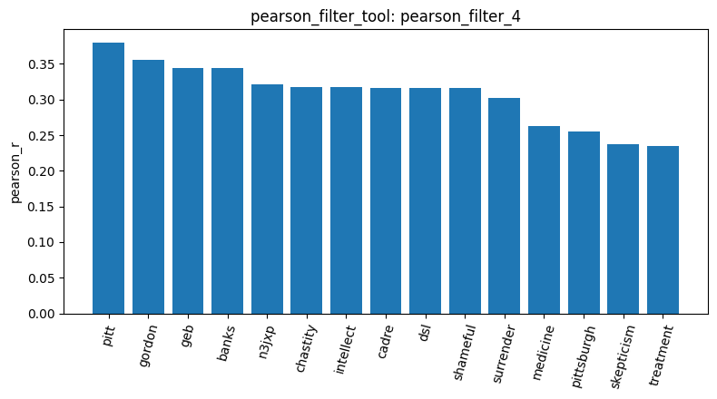
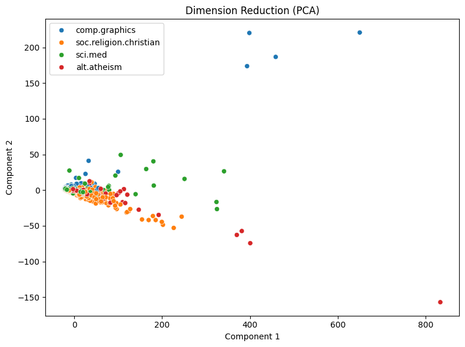

# Your report

I loaded 2,257 documents from four 20 Newsgroups categories using `load_dataset_1`: comp.graphics (584), soc.religion.christian (599), sci.med (594), and alt.atheism (480). I then built a Document-Term Matrix using `build_dtm_2`, containing 35,788 terms across 2,257 documents. Its 99.547% sparsity shows that most words occur in only a small number of documents.

Using `variance_filter_3` with a threshold of 0.01, I reduced the vocabulary from 35,788 to 5,354 terms, removing 30,434 low-variance terms. These were mainly rare names, typos, and document-specific tokens, so removing them reduces noise and makes later analysis more efficient. The Pearson filter (`pearson_filter_4`) selected 25 terms correlated with sci.med, including `medicine`, `treatment`, `diet`, and `sensitivity`. However, it evaluated all 35,788 DTM terms instead of only the variance-filtered terms, so the two filters did not combine as expected.

The PCA result (`reduce_dimensions_5`) reduced the DTM to two dimensions. PC1 explained 65.94% of the variance and PC2 explained 4.33%, meaning the first component dominates the projection. The plot shows substantial category overlap around the centre, with several strong outliers, so the four categories are not cleanly separated in two-dimensional PCA space. Cosine similarity between documents 0 and 1 was 0.353241, indicating moderate similarity between the two comp.graphics documents.

