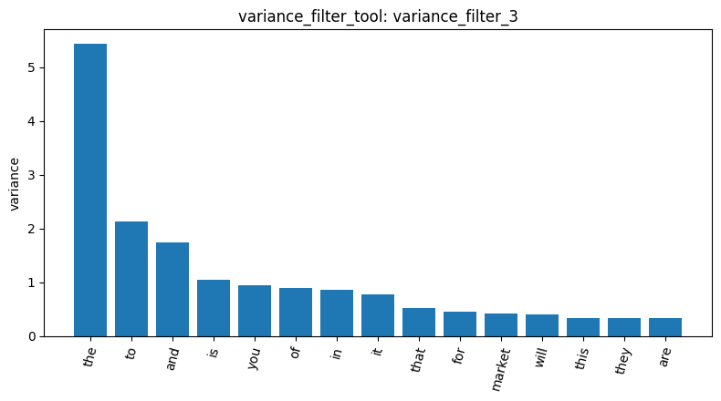
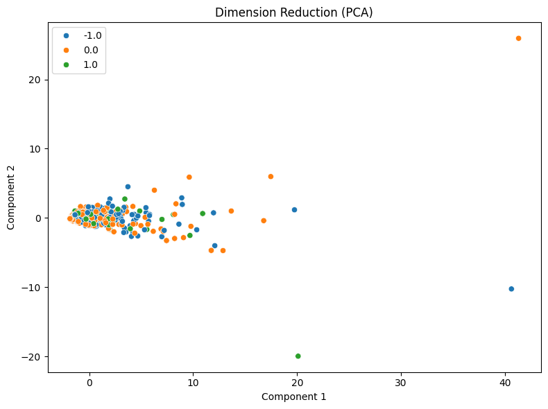

# Your report

I loaded `newdataset/Reddit-stock-sentiment.csv` with `load_dataset_tool`: 847 documents in three classes, `0.0` (423), `-1.0` (315) and `1.0` (109). After granting the agent access to my tools, `build_dtm_tool` (`build_dtm_2`) which produced an 847 × 4,346 matrix that is 99.53% sparse.

`variance_filter_tool` with threshold 0.01 (`variance_filter_3`) kept 506 of 4,346 terms. The top-variance terms are almost all stop words (the, to, and, is, you), with "market" the only domain word, so this filter removes rare terms but does not pick out class-relevant ones.

My first Pearson (`pearson_filter_4`) and Spearman (`spearman_filter_5`) runs used the default threshold of 0.0, so all 4,346 terms were kept and nothing was filtered. Both ran on the full DTM, not the 506-term subset. Re-running Pearson on class `1.0` with threshold 0.1 (`pearson_filter_7`) kept 41 terms, such as tldr, huge, nice, exciting, dividends and rklb, which suggests individual terms correlate only weakly with the label. `mine_patterns_tool` on class `-1.0` (`mine_patterns_6`, min_sup = 30) found only "trump" (45), "just" (42) and "china" (33).

PCA with two components (`reduce_dimensions_8`) shows the three classes overlapping in one dense cluster near the origin. A few outliers stretch the axes but show no class-level pattern, so two components do not separate the classes.

Overall, none of the views shows clear class separation. The main limitations are the uninformative 0.0 thresholds on the first correlation filters, the Spearman filter never being re-run with a higher threshold, and the correlation filters not being applied to the variance-filtered terms.
