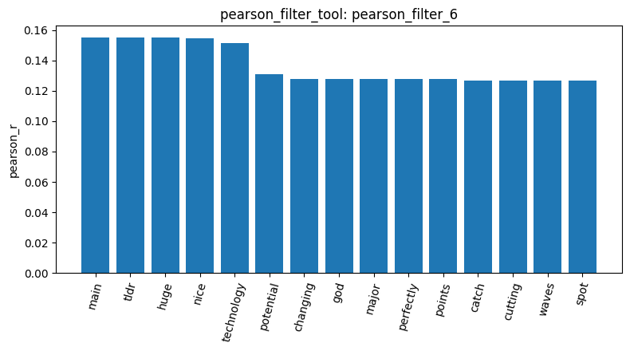

# Your report

I loaded the Reddit stock-sentiment dataset using `load_dataset_1`. It contained 847 posts with three sentiment labels: neutral (423), negative (315), and positive (109). Inspection with `inspect_data_2` showed that the dataset contains short, informal Reddit comments, ranging from brief phrases such as “Seeing lots of red in the ticker” to longer stock-related posts. I built a Document-Term Matrix in `build_dtm_3` with 847 documents and 4,346 terms. The matrix was 99.53% sparse, showing that most words occur in only a small fraction of posts.

I applied `variance_filter_4` with a threshold of 0.01. This reduced the vocabulary from 4,346 to 506 terms by removing 3,840 low-variance terms. Removing rare or uninformative terms reduces noise and makes later analysis more efficient, which is especially useful for short Reddit posts. Pearson filtering for positive sentiment with a threshold of 0.2 (`pearson_filter_5`) selected no terms, indicating that no individual term had a strong enough correlation with the positive label. After lowering the threshold to 0.1, `pearson_filter_6` selected 41 terms, including `huge`, `nice`, `potential`, `perfectly`, and `crush`. However, some selected terms such as `amd`, `rklb`, and `3d` may be stock tickers, Reddit-specific tokens, or technical vocabulary rather than pure sentiment indicators.

PCA in `reduce_dimensions_7` reduced the data to two components. PC1 explained 27.00% of variance and PC2 explained 4.99%, for approximately 32% combined. This limited proportion suggests that the two-dimensional projection does not fully represent the high-dimensional text data, and the negative, neutral, and positive sentiment classes were not clearly separated. Cosine similarity in `cosine_similarity_8` between documents 0 and 1 was 0.0, meaning they had no shared retained terms; this measures lexical overlap only and does not determine whether their sentiment labels are the same. K-Means clustering in `kmeans_9` also did not align well with the three sentiment classes: one cluster contained 784 documents, while the other two contained only 2 and 61 documents. The dominant terms in every cluster were common words such as `the`, `to`, and `and`, showing that the clusters were driven mainly by general word-frequency patterns rather than sentiment.

For supervised learning, I created a stratified 80/20 train-test split in `train_test_split_10`, producing 677 training and 170 test samples. The Multinomial Naïve Bayes model in `naive_bayes_11` achieved 55.29% test accuracy. However, `evaluate_model_12` showed weaker balanced performance, with macro precision of 0.3858, macro recall of 0.4357, and macro F1-score of 0.3990. The model correctly classified 49 negative and 45 neutral posts but did not correctly predict any positive posts, reflecting the smaller positive class and overlapping language across sentiment labels. Finally, FP-Growth pattern mining in `mine_patterns_13` found no positive-sentiment itemsets with TF-IDF filtering and minimum support of 20, meaning no word combination appeared frequently enough among positive posts. Overall, the workflow showed that feature filtering identifies potentially useful terms, but class imbalance and sparse, informal language make positive-sentiment detection difficult.